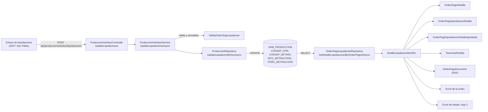

# Informe técnico - Requerimiento 01: campos SAP en liquidaciones y orden de pago

| Atributo | Valor |
|----------|-------|
| **Proyecto** | SHM - Sistema de Honorarios Médicos |
| **Autor** | ADG Antonio |
| **Fecha** | 2026-11-05 (actualizado 2026-11-11) |
| **Rama** | `antonio_v1` (cambios sin commit) |
| **Especificación** | [nuevos_campos_liquidacion.md](nuevos_campos_liquidacion.md) |
| **Guía de despliegue** | [req_01_guia_despliegue.md](req_01_guia_despliegue.md) |
| **Estado** | Implementado y compilado. Sin pruebas contra Oracle |
| **Dirigido a** | Desarrolladores que mantengan o revisen este cambio |

---

## 1. Resumen

El API de liquidaciones recibe ahora 4 datos de SAP por producción: `codSapCpm`, `codSapDetrac`, `mtoDetraccion` y `porcDetraccion`. Los datos se guardan en `SHM_PRODUCCION` y se muestran en el detalle de la orden de pago (4 vistas, PDF y 2 Excel).

| Métrica | Valor |
|---------|-------|
| Archivos modificados | 15 |
| Archivos nuevos | 4 (parche SQL, especificación, guía de despliegue, este informe) |
| Líneas | +339 / -51 |
| Columnas nuevas en BD | 2 (`CODSAP_CPM`, `CODSAP_DETRAC`) |
| Columnas reutilizadas | 2 (`MTO_DETRACCION`, `PORC_DETRACCION`) |
| Proyectos .NET tocados | `AppDomain`, `AppApplication`, `AppInfrastructure`, `AppWebHonorarioMedico` |
| Compilación | 0 errores, 5 advertencias (las mismas que antes del cambio) |

---

## 2. Flujo de datos



Hay un único punto de lectura: la consulta del detalle de la orden alimenta todas las salidas. Por eso agregar los datos allí los deja disponibles en las 4 vistas, el PDF y los 2 Excel sin consultas adicionales.

---

## 3. Modelo de datos

### 3.1 Columnas

| Columna | Tipo | Estado | Mapeo .NET |
|---------|------|--------|------------|
| `CODSAP_CPM` | `VARCHAR2(18)` | Nueva | `string?` (`Produccion.CodSapCpm`) |
| `CODSAP_DETRAC` | `VARCHAR2(20)` | Nueva | `string?` (`Produccion.CodSapDetrac`) |
| `MTO_DETRACCION` | `NUMBER` | Existente | `decimal?` |
| `PORC_DETRACCION` | `NUMBER(5,2)` | Existente | `decimal?` |

Notas:
- `NUMBER(5,2)` admite hasta `999.99`. La regla de negocio (0 a 100) es más estricta, y se valida en el servicio, no en la base de datos.
- `MTO_DETRACCION` es `NUMBER` sin escala, así que la base de datos no limita los decimales. Por eso el servicio valida el máximo de 2 decimales.
- Las columnas nuevas son `NULL` y sin `DEFAULT`. En Oracle 11g, esto solo modifica el diccionario de datos.

### 3.2 Semántica de las columnas existentes

Antes de este cambio, `MTO_DETRACCION` y `PORC_DETRACCION` se llenaban solo al registrar la producción (`POST /api/produccioninterface/producciones`), con la detracción calculada por San Pablo. Esos valores los lee el Portal de Compañías para mostrar el monto que debe consignar la compañía y para validar el XML de la factura.

Ahora la liquidación los sobrescribe con el valor de SAP. Ambos usos conviven en la misma columna, en momentos distintos del ciclo de la producción:

| Etapa | Estado de la producción | Origen del valor |
|-------|-------------------------|------------------|
| Registro | `FACTURA_PENDIENTE` | San Pablo (calculado) |
| Liquidación | `FACTURA_LIQUIDADA` | SAP (oficial) |

---

## 4. API de liquidaciones

### 4.1 DTO de entrada

`UpdateInterfaceLiquidacionDto` agrega 4 propiedades opcionales:

```csharp
public string?  CodSapCpm       { get; set; }  // máx. 18
public string?  CodSapDetrac    { get; set; }  // máx. 20
public decimal? MtoDetraccion   { get; set; }  // >= 0, 2 decimales
public decimal? PorcDetraccion  { get; set; }  // 0..100, 2 decimales
```

El serializador JSON de ASP.NET Core usa camelCase por defecto, así que los nombres públicos son `codSapCpm`, `codSapDetrac`, `mtoDetraccion` y `porcDetraccion`.

### 4.2 Validación y normalización

`ProduccionInterfaceService.ValidarDatosSapLiquidacion` es un método privado estático con parámetros `out`. Retorna el mensaje de error, o `null` si los datos son válidos.

```csharp
codSapCpm     = string.IsNullOrWhiteSpace(dto.CodSapCpm)    ? null : dto.CodSapCpm.Trim();
codSapDetrac  = string.IsNullOrWhiteSpace(dto.CodSapDetrac) ? null : dto.CodSapDetrac.Trim();
mtoDetraccion = dto.MtoDetraccion  ?? 0m;
porcDetraccion = dto.PorcDetraccion ?? 0m;

if (codSapCpm    != null && codSapCpm.Length    > 18) return "codSapCpm excede la longitud maxima de 18 caracteres";
if (codSapDetrac != null && codSapDetrac.Length > 20) return "codSapDetrac excede la longitud maxima de 20 caracteres";
if (mtoDetraccion < 0)                                return "mtoDetraccion no puede ser negativo";
if (Math.Round(mtoDetraccion, 2) != mtoDetraccion)    return "mtoDetraccion admite como maximo 2 decimales";
if (porcDetraccion < 0 || porcDetraccion > 100)       return "porcDetraccion debe estar entre 0 y 100";
if (Math.Round(porcDetraccion, 2) != porcDetraccion)  return "porcDetraccion admite como maximo 2 decimales";
```

Decisiones de diseño:
- **Se valida antes de consultar sede y entidad.** Un registro inválido no genera consultas a la base de datos.
- **Un registro inválido devuelve `ER` y el lote continúa**, igual que las demás validaciones del método.
- **Nulo equivale a `0`** en monto y porcentaje, y a `NULL` en los códigos.
- **No se valida consistencia** entre código, monto y porcentaje (decisión confirmada).

### 4.3 Persistencia

`ProduccionRepository.UpdateLiquidacionByKeyAsync` recibe 4 parámetros nuevos y los incluye en el `UPDATE`:

```sql
UPDATE SHM_PRODUCCION
SET   NUMERO_LIQUIDACION = :NumeroLiquidacion,
      ...
      TIPO_LIQUIDACION   = :TipoLiquidacion,
      CODSAP_CPM         = :CodSapCpm,
      CODSAP_DETRAC      = :CodSapDetrac,
      MTO_DETRACCION     = :MtoDetraccion,
      PORC_DETRACCION    = :PorcDetraccion,
      ESTADO             = :Estado,
      ID_MODIFICADOR     = :IdModificador,
      FECHA_MODIFICACION = SYSDATE
WHERE ID_SEDE = :IdSede AND ID_ENTIDAD_MEDICA = :IdEntidadMedica
  AND CODIGO_PRODUCCION = :CodigoProduccion AND NUMERO_PRODUCCION = :NumeroProduccion
  AND TIPO_ENTIDAD_MEDICA = :TipoEntidadMedica
  AND ESTADO = :EstadoRequerido
```

- Las 4 columnas se asignan **siempre**, sin `NVL` ni `COALESCE`: SAP es la fuente oficial y sobrescribe.
- La condición `ESTADO = FACTURA_ENVIADA_HHMM` se mantiene. Garantiza de forma atómica que una producción ya liquidada no se vuelva a modificar, y por eso estos datos no se pueden corregir reenviando la liquidación.
- El `SELECT` base de la entidad (`ProduccionRepository`, usado por los métodos `GetXxxAsync`) ahora incluye `CODSAP_CPM` y `CODSAP_DETRAC`. Esto crea una **dependencia dura con el parche**: sin las columnas, todas las lecturas de producción fallan con `ORA-00904`.

### 4.4 Manejo de errores de formato

Los errores de negocio (longitud, rango, decimales) se informan por registro. Los errores de **tipo JSON** son distintos: por ejemplo, enviar `"mtoDetraccion": "12.00"` como texto en vez de número. El controlador tiene `[ApiController]`, así que el enlace del modelo rechaza **toda la solicitud** con HTTP 400. Es el comportamiento estándar de ASP.NET Core y no se probó en este desarrollo. Por eso se confirmó con el equipo emisor que los valores van como número JSON.

---

## 5. Lectura para la orden de pago

### 5.1 Consulta y DTO

`OrdenPagoLiquidacionRepository.GetDetalleLiquidacionesByOrdenPagoIdAsync` agrega al `SELECT`:

```sql
T1.CODSAP_CPM      AS CodSapCpm,
T1.CODSAP_DETRAC   AS CodSapDetrac,
T1.MTO_DETRACCION  AS MtoDetraccion,
T1.PORC_DETRACCION AS PorcDetraccion,
```

`DetalleLiquidacionItemDto` agrega las 4 propiedades y un indicador calculado:

```csharp
public bool TieneDetraccion =>
    !string.IsNullOrWhiteSpace(CodSapDetrac) || (MtoDetraccion ?? 0) > 0;
```

Al ser de solo lectura, Dapper no intenta asignarla al mapear. Es la **única regla** para decidir si se muestra la detracción o un `-`, y la usan las vistas, el PDF y los Excel. Considera código SAP **o** monto mayor a 0, para que las producciones liquidadas antes de este cambio, que ya tenían monto pero no código, no oculten un valor válido.

### 5.2 Totales

No se agregaron columnas de detracción a `SHM_ORDEN_PAGO` ni a `SHM_ORDEN_PAGO_LIQUIDACION` (donde se guardan los acumulados `MTO_*_ACUM`). El total de detracción se calcula sumando el detalle en cada salida. Así se evita cambiar el proceso que genera la orden, recalcular datos históricos y agregar otra migración.

---

## 6. Presentación

### 6.1 Vistas Razor (4)

Se modificó la tabla de comprobantes en `OrdenPago/Detalle`, `OrdenPagoAprobacion/Detalle`, `OrdenPagoAprobacion/DetalleAprobada` y `Tesoreria/Detalle`:

- **Código SAP de la factura:** una línea `SAP: <código>` bajo el comprobante. No se agregó columna, porque las tablas ya tienen hasta 16 columnas visibles.
- **Columna "Detracción S/."** antes del Total, con el monto, el porcentaje y el código SAP de la detracción, o `-`.
- **Pie:** el total de detracción suma `MtoDetraccion` del detalle.
- **Fila vacía:** su `colspan` aumenta en 1.

La celda de detracción incluye el valor numérico en un atributo de datos, para que el JavaScript no tenga que interpretar el texto de varias líneas:

```razor
<td class="text-right" data-monto="@((det.MtoDetraccion ?? 0).ToString("F2", CultureInfo.InvariantCulture))">
    @if (det.TieneDetraccion) { ...monto, %, SAP... } else { <span class="text-muted">-</span> }
</td>
```

### 6.2 JavaScript de Tesorería

`recalcularTotales` recalcula el pie con las filas visibles al filtrar por liquidación. Lee las celdas por posición, y se agregó `parseMontoData`, que lee `data-monto`.

| Total | Índice original | Índice real antes del cambio | Índice final |
|-------|-----------------|------------------------------|--------------|
| Sub Total | 11 | 13 | **13** |
| IGV | 12 | 14 | **14** |
| Imp. Renta | 13 | 15 | **15** |
| Detracción | - | - | **16** (`data-monto`) |
| Total | 14 | 17 | **17** |

**Hallazgo.** El código original ya leía índices desfasados por 2: las columnas PDF y XML se agregaron después sin actualizar el script. Los índices 11 a 14 correspondían a XML, Estado, Sub Total e IGV, así que los totales del pie salían incorrectos al filtrar, antes de este requerimiento. Al añadir la columna de detracción se corrigieron todos los índices. Con la columna nueva, las filas tienen 18 celdas (índices 0 a 17), la primera oculta (casilla de selección).

### 6.3 PDF (`OrdenPagoDocument`)

`ComposeDetalle` pasa de 13 a 14 columnas (A4 horizontal):

- Se agrega la columna "Detracción S/." y una columna relativa más en `ColumnsDefinition`.
- El código SAP de la factura se agrega al texto del comprobante: `"{comprobante}\nSAP: {código}"`.
- El helper nuevo `FilaCeldaDetraccion` muestra el monto, y debajo el porcentaje y `SAP: <código>` en letra de 6 pt gris, o `-`.
- Se agrega el total de detracción al pie.
- El `ColumnSpan(9)` de la etiqueta "TOTAL GENERAL" **no cambia**, porque las 9 columnas anteriores a los montos siguen siendo las mismas.

### 6.4 Excel de la orden (`DescargarExcelOrdenPago`)

Pasa de 14 a 17 columnas. La columna 13, que antes estaba fija en `0` ("campo futuro"), ahora tiene datos.

| # | Columna | # | Columna |
|---|---------|---|---------|
| 1 | # | 10 | Estado |
| 2 | Liquidación | 11 | Sub Total S/. |
| 3 | RUC | 12 | IGV S/. |
| 4 | Cod. Acreedor | 13 | Imp. Renta S/. |
| 5 | Cía Médica | 14 | **Cód. SAP Detracción** |
| 6 | Banco | 15 | **% Detracción** |
| 7 | Comprobante | 16 | **Detracción S/.** |
| 8 | **Cód. SAP Factura** | 17 | Total S/. |
| 9 | F. Emisión | | |

Cambios asociados: los rangos combinados del logo y del título ahora abarcan 17 columnas; la etiqueta "TOTAL:" pasa de la columna 9 a la 10; las columnas con suma son 11, 12, 13, 16 y 17.

Para el monto de detracción se usa el formato `#,##0.00;-#,##0.00;"-"`. El valor `0` se muestra como `-` y la celda sigue siendo numérica, así que la fórmula `SUM` funciona. El porcentaje se escribe como número si la factura tiene detracción, y como `-` si no.

### 6.5 Excel de listado (`ExportarExcel`, hoja "Detalle de Liquidaciones")

Pasa de 16 a 20 columnas con las mismas 4 columnas nuevas (11 `Cód. SAP Factura`, 17 `Cód. SAP Detracción`, 18 `% Detracción`, 19 `Detracción S/.`). Los 3 rangos combinados del encabezado pasan a 20 columnas. Esta hoja no tiene fila de totales.

---

## 7. Decisiones de diseño y alternativas

| Tema | Decisión | Alternativa descartada | Motivo |
|------|----------|------------------------|--------|
| Monto y porcentaje de detracción | Reutilizar `MTO_DETRACCION` y `PORC_DETRACCION` | Columnas nuevas `MTO_DETRAC` y `POR_DETRAC` | Evita dos pares casi idénticos. Decisión del usuario |
| Valor existente | SAP sobrescribe siempre | Conservar si SAP envía vacío | SAP es la fuente oficial. Decisión del usuario |
| Vacío en monto o porcentaje | Guardar `0` | Guardar `NULL` | Coincide con el contrato del endpoint de producciones ("si no aplica, enviar 0") |
| Total de detracción | Sumar el detalle | Columnas `MTO_DETRAC_ACUM` en orden y liquidación | Sin migración, sin recalcular histórico, sin tocar la generación de órdenes |
| Código SAP de la factura | Línea bajo el comprobante | Columna propia en vistas y PDF | Las tablas ya son anchas. En Excel sí hay columna propia |
| Regla de "tiene detracción" | Código SAP **o** monto > 0 | Solo código SAP | No ocultar montos de producciones liquidadas antes del cambio |
| Ceros en Excel | Formato numérico que muestra `-` | Escribir el texto `-` | Mantiene la columna sumable |
| Validación | Antes de consultar la base de datos | Después de resolver sede y entidad | Evita consultas inútiles |
| Parche SQL | Una columna por `ALTER`, sin `DEFAULT` | `ADD ... DEFAULT 0` | En Oracle 11g, el `DEFAULT` reescribe la tabla |

---

## 8. Compatibilidad

- **API:** los 4 campos son opcionales, así que los emisores actuales no reciben error. **Efecto colateral:** quien no envíe `mtoDetraccion` y `porcDetraccion` deja la detracción en `0` al liquidar, aunque la producción tuviera un valor al registrarse.
- **Base de datos:** el parche solo agrega columnas, y el código anterior funciona con ellas presentes. El código nuevo **no** funciona sin el parche (`ORA-00904`).
- **Portal de Compañías:** no se modificó. Comparte las bibliotecas con los otros proyectos, pero no necesita republicarse.
- **Excel:** las posiciones de las columnas cambian. Los procesos que lean los archivos por número de columna deben actualizarse.

---

## 9. Hallazgos y deuda técnica

Detectados durante el desarrollo.

| # | Hallazgo | Ubicación | Estado |
|---|----------|-----------|--------|
| 1 | Los totales por fila visible en Tesorería leían columnas equivocadas (desfase de 2) | `Tesoreria/Detalle.cshtml` | **Corregido** en este cambio |
| 2 | `CREATE TABLE SHM_PRODUCCION` con comas faltantes alrededor de `MTO_DETRACCION` y columna `FACTURA_FECHA_VENCIMIENTO` duplicada | `db/02_create_tables.sql` | Sin corregir |
| 3 | `updateDto.TipoLiquidacion ?? "".Trim()` aplica `Trim()` solo al texto vacío, no al valor recibido | `ProduccionInterfaceService.cs` (línea del `UpdateLiquidacionByKeyAsync`) | Sin corregir |
| 4 | La documentación dice que una producción inexistente se "omite" (`cantidadObviados`), pero el código responde `ER` con "Produccion no encontrada" | `docs/API_ProduccionInterface.md` y `UpdateLiquidacionesAsync` | Sin corregir |
| 5 | El endpoint de liquidaciones no tiene `[Authorize]` ni API key a nivel de controlador | `ProduccionInterfaceController` | Sin corregir |
| 6 | `idModificador` fijo en `1` | `ProduccionInterfaceController` | Sin corregir |
| 7 | La hoja de detalle del Excel de listado consulta el detalle de cada orden en un bucle (una consulta por orden) | `TesoreriaController.ExportarExcel` | Sin corregir. Ya existía antes del cambio |
| 8 | La solución no contiene proyecto de pruebas automatizadas | `src/` | Sin corregir |

---

## 10. Verificación

**Realizada**
- Compilación de la solución completa: correcta, 0 errores.
- Las vistas Razor se compilan en el ensamblado durante el build. Se comprobó que el ensamblado contiene el tipo `Views_Tesoreria_Detalle`, así que los cambios de Razor están validados sintácticamente.
- Revisión de índices de columna de la tabla de Tesorería contra su definición (ver sección 6.2).

**Pendiente** (detalle en la sección 8 de la guía de despliegue)
- Aplicar el parche y ejecutar el flujo completo contra Oracle: envío de liquidaciones, validaciones por registro y lectura en la orden de pago.
- Comprobación visual de las 4 vistas, del PDF (sin columnas cortadas en A4 horizontal) y de los 2 Excel.
- Verificar que ninguna pantalla del Portal de Compañías valide facturas de producciones ya liquidadas.
- No se agregaron pruebas automatizadas.

---

## 11. Archivos modificados

| Capa | Archivo |
|------|---------|
| BD | `db/parches/patch_20261105_campos_liquidacion_sap.sql` (nuevo), `db/02_create_tables.sql` |
| Dominio | `Entities/Produccion.cs`, `DTOs/Produccion/UpdateInterfaceLiquidacionDto.cs`, `DTOs/OrdenPagoLiquidacion/DetalleLiquidacionItemDto.cs`, `Interfaces/Repositories/IProduccionRepository.cs` |
| Aplicación | `Services/ProduccionInterfaceService.cs` |
| Infraestructura | `Repositories/ProduccionRepository.cs`, `Repositories/OrdenPagoLiquidacionRepository.cs` |
| Portal Administrativo | `Views/OrdenPago/Detalle.cshtml`, `Views/OrdenPagoAprobacion/Detalle.cshtml`, `Views/OrdenPagoAprobacion/DetalleAprobada.cshtml`, `Views/Tesoreria/Detalle.cshtml`, `Reports/OrdenPagoDocument.cs`, `Controllers/TesoreriaController.cs` |
| Documentación | `docs/API_ProduccionInterface.md`, y 3 documentos en `docs/requerimientos/01_campos_liquidacion/` |
