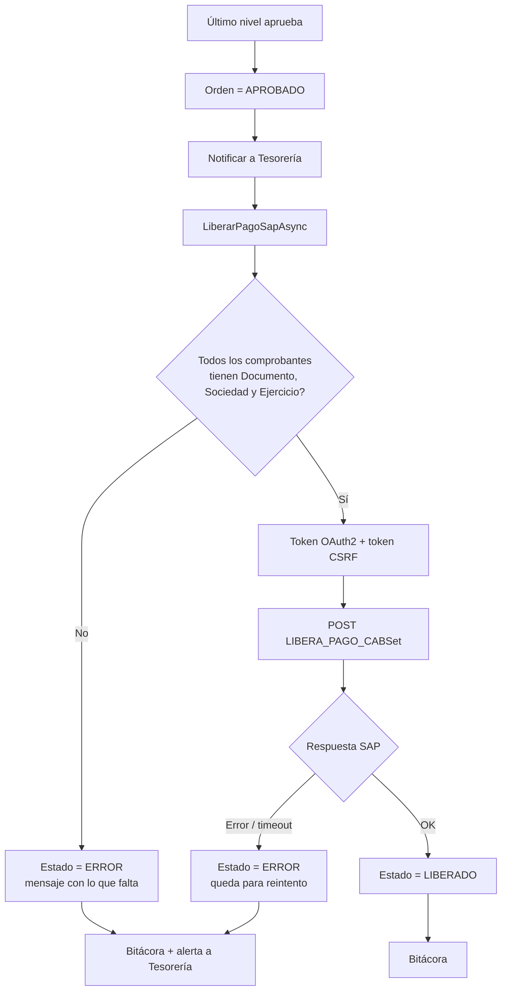

# Req 02 - Liberación de pagos en SAP: Propuesta de solución

| Campo | Valor |
|-------|-------|
| **Requerimiento** | `02_requerimiento.md` |
| **Especificación SAP** | `ServicioLiberacionPagos.pdf` (v1.0.0, entorno QAS, Jorge Ramírez, 05/11/2026) |
| **Autor** | ADG Antonio |
| **Fecha** | 2026-11-11 |
| **Estado** | Propuesta, pendiente de validar los puntos de la sección 8 |

---

## 1. Requerimiento

Cuando una orden de pago queda **aprobada por completo**, el sistema debe liberar en SAP todas las facturas o boletas que contiene, llamando al servicio que entregó el equipo SAP. Una orden de pago puede tener varios comprobantes.

## 2. Análisis de la especificación SAP

El servicio es OData sobre el mismo gateway que ya usamos (`ZODGS_PORTAL_HHMM_SRV`, host `190.12.87.190:8124`). La secuencia es:

| # | Paso | Detalle |
|---|------|---------|
| 1 | Token OAuth2 | Igual al existente en `SapApiService.GetTokenAsync()` (Basic Auth + client_credentials). Se reutiliza. |
| 2 | Token CSRF | `GET .../ZODGS_PORTAL_HHMM_SRV/$metadata` con el header `X-CSRF-Token: Fetch`. SAP responde el token en el header `X-CSRF-Token` y una cookie de sesión. |
| 3 | Liberar | `POST .../LIBERA_PAGO_CABSet` con el Bearer, el `X-CSRF-Token` y la cookie de sesión del paso 2. |

El body es una **cabecera con una lista de documentos** (`IdOrden`, `Fecha`, `Documentos[]`). Esto calza con el requerimiento: **un solo POST por orden de pago**, con un elemento por comprobante.

> Los headers, el body del token y la respuesta están en `documentacion_api_servicio_liberacion_pagos.md` (transcripción de las capturas del PDF). Lo que se confirmó:
> - El token OAuth2 es `POST` form-urlencoded, igual al `GetTokenAsync()` actual (mismo usuario, scope y endpoint).
> - El CSRF se pide con el header `x-csrf-token: fetch` y la respuesta trae `x-csrf-token` y cookies, que hay que reenviar.
> - La liberación responde **`201 Created`** con `d.Status = "OK"` y `d.Mensaje = "Documentos recibidos"`. `d.Documentos.results` viene vacío.
> - La respuesta es **a nivel de la orden**, no por documento. El `201` solo indica que SAP recibió el POST, así que hay que revisar también `Status`. El formato de una respuesta de error no está documentado.

### Mapeo de campos

| Campo SAP | Long. | Req. | Origen en SHM | Estado |
|-----------|-------|------|---------------|--------|
| `IdOrden` | 20 | Key | `SHM_ORDEN_PAGO.NUMERO_ORDEN_PAGO` | Disponible |
| `Fecha` | 10 | Opc. | Fecha de la aprobación final (`FechaAprobacion`) | Disponible |
| `Sociedad` | 4 | Key | `SHM_SEDE.CODIGO_SOCIEDAD_SAP` de la sede de la orden (columna nueva, decidido) | Parche y pantalla de sedes listos. Falta cargar los códigos |
| `Documento` | 10 | Key | `SHM_PRODUCCION.CODSAP_CPM` (Req 01) | Disponible desde Req 01. Las producciones anteriores no lo tienen |
| `Ejercicio` | 4 | Key | Año de `FechaEmision` del comprobante (decidido) | Disponible, se calcula |
| `DocumentoDt` | 10 | Opc. | `SHM_PRODUCCION.CODSAP_DETRAC` (Req 01) | Disponible. Solo si la factura tiene detracción |
| `Referencia` | 16 | Opc. | `{tipo}-{Serie}-{Numero}` con el tipo de comprobante SUNAT: factura `01`, recibo por honorarios `02` (ej. `01-F001-0004521`, `02-E001-0000502`, decidido). El número lleva ceros a la izquierda hasta 7 dígitos | Disponible. **El código de tipo de la Referencia es distinto del campo `TipoComprobante`** (ahí el recibo por honorarios sigue como `03`). Máx. 16 caracteres: serie de 4 y número de hasta 8 dígitos |
| `Ruc` | 20 | Opc. | RUC de la entidad médica | Disponible |
| `ProveedorName` | 35 | Opc. | Razón social de la entidad médica | Disponible. **Truncar a 35** |
| `TipoComprobante` | 2 | Opc. | Tipo del comprobante: `1` → `01`, `22` → `03` (decidido) | Disponible. Un tipo distinto de `1` y `22` se marca como error de validación |
| `FechaEmision` | 10 | Opc. | `FechaEmision` del comprobante | Disponible |
| `Importe` | 24,3 | Opc. | `MtoTotal` del comprobante (monto total), con 3 decimales como texto, ej. `12500.500` (decidido) | Disponible |
| `Moneda` | 5 | Opc. | Código ISO de la cuenta bancaria de la producción: `SHM_PRODUCCION.ID_CUENTA_BANCO` → `SHM_ENTIDAD_CUENTA_BANCO.MONEDA` (`PEN` Soles, `USD` Dólares). Se envía el código, no la descripción (decidido) | Disponible. Hay que agregar `MONEDA` a la consulta de detalle de la orden. Si es nula o distinta de `PEN`/`USD`, se marca error de validación |
| `UserLiberador` | 12 | Opc. | Login (`SHM_SEG_USUARIO.LOGIN`) del usuario que aprobó el último nivel (decidido). Si supera 12 caracteres se trunca a los primeros 12 | Disponible. El login admite hasta 100 caracteres en SHM |
| `FechaLibera` | 10 | Opc. | Fecha de la aprobación final | Disponible |
| `HoraLibera` | 10 | Opc. | Hora de la aprobación final | Disponible |
| `Estado` | 10 | Opc. | `APROBADO` | Fijo |

**Datos clave:** `Sociedad` sale de `SHM_SEDE.CODIGO_SOCIEDAD_SAP` (hay que cargar el código de cada sede) y `Ejercicio` es el año de la fecha de emisión del comprobante. Los dos forman parte de la clave del documento en SAP.

## 3. Propuesta de solución

### 3.1 Punto de disparo

En `OrdenPagoAprobacionService.AprobarAsync`, en la rama donde ya no quedan niveles pendientes (hoy actualiza el estado a `APROBADO` y llama a `NotificarTesoreriaAsync`). Se agrega, después del cambio de estado:

```
UpdateEstadoAsync(APROBADO)
NotificarTesoreriaAsync(...)
LiberarPagoSapAsync(idOrdenPago)      <- nuevo
```

### 3.2 La aprobación no depende de SAP

Si SAP está caído, la aprobación **no se revierte**. Es el mismo criterio que ya se usa con los correos (la falla se registra y no afecta la aprobación). El resultado de la liberación se guarda y se puede **reintentar**.



### 3.3 Componentes

| Capa | Archivo | Cambio |
|------|---------|--------|
| Domain | `DTOs/SapApi/SapLiberaPagoRequestDto.cs`, `SapLiberaPagoDocumentoDto.cs`, `SapLiberaPagoResponseDto.cs` | Nuevos. Nombres JSON en PascalCase como en el PDF |
| Domain | `DTOs/SapApi/SapApiSettings.cs` | Agregar `EndpointMetadata`, `EndpointLiberaPago` |
| Domain | `Interfaces/Services/ISapApiService.cs` | Agregar `LiberarPagoAsync(request)` |
| Application | `Services/SapApiService.cs` | Implementar: obtener CSRF y hacer el POST |
| Domain / Infra | `Entities/OrdenPagoLiberacion.cs` + repositorio | Registro del resultado por comprobante (ver 3.4) |
| Application | `Services/OrdenPagoAprobacionService.cs` | Armar el request, llamar a SAP, guardar resultado |
| Application | `Services/OrdenPagoLiberacionService.cs` | Reintento manual de una orden |
| Web | Vistas de detalle de orden de pago y Tesorería | Estado de liberación y botón "Reintentar" |
| BD | `db/parches/patch_2026MMDD_liberacion_pagos.sql` | Tabla nueva (ver 3.4) y secuencia |

**Cuidado técnico con el CSRF:** el token CSRF de SAP está ligado a la **cookie de sesión** que se devuelve en el mismo GET. Hay que enviar ese `Set-Cookie` de vuelta en el POST. El `HttpClient` tipado actual no guarda cookies, así que `LiberarPagoAsync` debe copiar las cookies de la respuesta al request siguiente (o usar un `CookieContainer` por llamada). Si no, SAP responde 403 `CSRF token validation failed`.

### 3.4 Persistencia: tabla `SHM_ORDEN_PAGO_LIBERACION`

Se propone una tabla en lugar de columnas en la orden, porque hay varios comprobantes por orden, permite el reintento por documento y deja el historial de intentos.

| Columna | Tipo | Descripción |
|---------|------|-------------|
| `ID_ORDEN_PAGO_LIBERACION` | NUMBER | PK (secuencia `SHM_ORDEN_PAGO_LIBERACION_SEQ`) |
| `ID_ORDEN_PAGO` | NUMBER | FK a `SHM_ORDEN_PAGO` |
| `ID_PRODUCCION` | NUMBER | FK a `SHM_PRODUCCION` (el comprobante) |
| `SOCIEDAD`, `DOCUMENTO`, `EJERCICIO`, `DOCUMENTO_DT` | VARCHAR2 | Datos enviados |
| `ESTADO_LIBERACION` | VARCHAR2(20) | `PENDIENTE`, `LIBERADO`, `ERROR` |
| `INTENTOS` | NUMBER | Cantidad de intentos |
| `FECHA_LIBERACION` | DATE | Cuándo SAP confirmó |
| `MENSAJE_SAP` | VARCHAR2(2000) | Mensaje de error o de respuesta |
| `REQUEST_JSON` / `RESPONSE_JSON` | CLOB | Trazabilidad para soporte |
| `GUID_REGISTRO`, `ACTIVO`, `ID_CREADOR`, `FECHA_CREACION`, `ID_MODIFICADOR`, `FECHA_MODIFICACION` | | Campos de auditoría estándar |

El estado de la orden de pago **no cambia** (sigue `APROBADO`). `PAGADO` se mantiene para el pago posterior. La liberación se ve como un estado aparte.

### 3.5 Reglas de negocio propuestas

1. Se liberan **todos** los comprobantes activos de la orden en un solo POST.
2. Antes de llamar a SAP se valida que cada comprobante tenga `Documento` (`CODSAP_CPM`), `FechaEmision` (para el `Ejercicio`) y que su sede tenga `Sociedad`. Si falta alguno, no se llama a SAP, se marca `ERROR` con el detalle de qué comprobante y qué dato falta.
3. Un `ERROR` se puede reintentar. Un `LIBERADO` no se vuelve a enviar.
4. SAP responde por orden y no por documento. Por eso el resultado (`Status` y `Mensaje`) se guarda igual en todos los comprobantes de esa orden, y el reintento vuelve a enviar la orden completa.
5. Cada intento deja un registro en bitácora (`SHM_ORDEN_PAGO`, acción `LIBERACION_SAP`).
6. Si falla, se avisa por correo a los destinatarios de `TESORERIA_EMAILS`.

### 3.6 Pantalla

En el detalle de la orden de pago (y en Tesorería):
- Badge de liberación: `Pendiente`, `Liberada`, `Con error`.
- Por comprobante: el estado y el mensaje de SAP, en el bloque que hoy muestra `SAP: <código>`.
- Botón **Reintentar liberación**, visible solo si hay errores y para el rol de Tesorería o administrador.

## 4. Alternativas consideradas

| Opción | Ventaja | Desventaja | Decisión |
|--------|---------|------------|----------|
| **A. Llamada directa al aprobar, sin bloquear** (propuesta) | Simple, sin infraestructura nueva, resultado inmediato | Si SAP tarda, el aprobador espera hasta el timeout (30 s) | **Recomendada** |
| B. Llamada que bloquea y revierte la aprobación si falla | Consistencia total | Con SAP caído nadie puede aprobar | Descartada |
| C. Proceso en segundo plano con cola | No hace esperar al aprobador, reintentos automáticos | Requiere un servicio nuevo (hoy no hay jobs) | Fase 2 si hace falta |

Si el tiempo de respuesta de SAP es un problema, la variante es lanzar la liberación sin esperarla (`Task.Run` con scope propio) y mostrar el estado en pantalla. Se puede decidir después de medir el tiempo real en QAS.

## 5. Dependencias y riesgos

| Riesgo | Impacto | Mitigación |
|--------|---------|------------|
| **Req 01 aún sin publicar** | Sin `CODSAP_CPM` no hay `Documento` | Publicar primero el Req 01 y su parche |
| **Producciones históricas sin `CODSAP_CPM`** | Órdenes con comprobantes viejos no se pueden liberar | Validar antes de llamar y mostrar el mensaje. Definir si se cargan a mano |
| **`Ejercicio` calculado con la fecha de emisión** | Si el documento se contabilizó en SAP en otro año (ej. factura emitida en diciembre y registrada en enero), la clave no coincide y SAP no encuentra el documento | Confirmar con SAP el caso de cambio de año (punto 8.2). Cargar los códigos de sociedad con el parche `patch_20261111_sede_codigo_sociedad_sap.sql` |
| **CSRF y cookies** | 403 si no se envía la cookie | Ver 3.3, probarlo primero con Postman |
| **Certificado SSL** | El proyecto ya acepta cualquier certificado en el `HttpClient` de SAP (`DangerousAcceptAnyServerCertificateValidator`) | Deuda existente, no se agrava. Revisar antes de producción |
| **Entorno solo QAS** | El PDF indica QAS | Pedir las URL y credenciales de producción al equipo SAP |
| **Credenciales en `appsettings.json`** | Ya existe para bancos | Mantener el mismo manejo, sin credenciales nuevas |

## 6. Plan de trabajo

| Fase | Contenido |
|------|-----------|
| 0 | Resolver los puntos de la sección 8 con SAP. Probar los 3 pasos en Postman y guardar las respuestas reales |
| 1 | Parche BD (tabla y secuencia), entidad, repositorio, DTOs y `SapApiService.LiberarPagoAsync` con CSRF |
| 2 | Integración en `AprobarAsync`, validaciones, bitácora y correo de falla |
| 3 | Pantalla: badge, detalle por comprobante y botón de reintento |
| 4 | Pruebas en QAS: orden con 1 y con varios comprobantes, comprobante con y sin detracción, SAP caído, reintento |
| 5 | Documentación y guía de despliegue (parche, `appsettings`, orden de publicación) |

## 7. Pruebas a realizar

- Orden con un comprobante: queda `LIBERADO`.
- Orden con varios comprobantes: un solo POST, todos `LIBERADO`.
- Comprobante con detracción: se envía `DocumentoDt`. Sin detracción: va vacío.
- Comprobante sin `CODSAP_CPM`: no se llama a SAP, queda `ERROR` con el detalle.
- SAP caído o timeout: la orden sigue `APROBADO`, la liberación queda `ERROR` y el reintento funciona.
- CSRF vencido: se obtiene otro token y se reintenta una vez.
- Reintento de una orden ya `LIBERADA`: no vuelve a llamar a SAP.
- Nombre de proveedor de más de 35 caracteres: se trunca sin error.

## 8. Puntos por confirmar con el equipo SAP / negocio

| # | Pregunta | A quién | Por qué importa |
|---|----------|---------|-----------------|
| 8.1 | Para cargar `CODIGO_SOCIEDAD_SAP` en `SHM_SEDE`: ¿qué código SAP corresponde a cada sede? | SAP | Se decidió guardarla por sede. Solo falta el dato |
| 8.2 | Se decidió `Ejercicio` = año de `FechaEmision`. Confirmar que SAP registra las facturas en el año de emisión, incluso en cambio de año (factura de diciembre ingresada en enero) | SAP | Si difiere, SAP no encuentra el documento. La alternativa sería que SAP envíe el ejercicio junto con `codSapCpm` en la liquidación |
| 8.3 | ~~`Importe` total o neto de detracción~~ | Tesorería | **Resuelto**: es el monto total del comprobante |
| 8.4 | ¿La operación es atómica (todo o nada)? ¿Cómo responde ante un error: HTTP 4xx/5xx, o `201` con `Status` distinto de `OK`? ¿Qué valores puede tener `Status`? La respuesta de éxito ya se conoce (`Status: OK`, `Documentos.results` vacío) | SAP | Define cómo se detecta el fallo y cómo se reintenta |
| 8.5 | ¿Es seguro volver a enviar un documento ya liberado (idempotente) o responde error? | SAP | Define el reintento |
| 8.6 | ~~Valor de `UserLiberador`~~ | SAP | **Resuelto**: login del último aprobador, truncado a 12 caracteres si es más largo |
| 8.7 | ~~Códigos de `TipoComprobante`~~ | SAP | **Resuelto**: en el campo `TipoComprobante`, `1` → `01` y `22` → `03`. **No se aplica a la Referencia**, que usa `01` para factura y `02` para recibo por honorarios (pruebas con SAP, 2026-11-16). Pendiente de confirmar si `TipoComprobante` del recibo por honorarios también debe ser `02` |
| 8.8 | ~~Formato de `Referencia`~~ | SAP | **Resuelto**: lleva el código de tipo al inicio: `01-F001-0004521` (factura) y `02-E001-0000502` (recibo por honorarios) |
| 8.9 | ~~Headers y respuesta de los pasos 1 a 3~~ | SAP | **Resuelto** con `documentacion_api_servicio_liberacion_pagos.md` |
| 8.10 | ¿Qué pasa con las órdenes ya aprobadas antes de publicar? ¿Se liberan de forma masiva o solo las nuevas? | Negocio | Si es masiva, hace falta una opción para liberar en lote |
| 8.11 | ¿Quién puede reintentar la liberación (rol)? | Negocio | Permisos del botón |
| 8.12 | ¿Existe un servicio para **consultar** si un documento ya está liberado? | SAP | Sirve para conciliar y para el reintento seguro |
| 8.13 | `Importe` se envía en la moneda del comprobante (`PEN` o `USD`), sin conversión. La descripción del campo dice "importe en moneda local": ¿SAP espera todo en soles, o acepta el monto en la moneda indicada en `Moneda`? | SAP | Si espera moneda local, los comprobantes en dólares irían con un monto equivocado |

## 9. Recomendación

Avanzar con la **opción A** (llamada directa sin bloquear la aprobación, con tabla de resultados y reintento manual). Los campos del request ya están definidos. Lo que queda por consultar a SAP es: 8.1 (códigos de sociedad por sede, necesarios para probar), 8.4 (respuesta ante un error), 8.5 (reenvío de un documento ya liberado) y la confirmación del 8.2 (cambio de año). Con eso resuelto o en paralelo, se puede empezar el desarrollo (tabla, `SapApiService`, integración y pantalla).

## 10. Estado de la implementación (2026-11-11)

Implementado y compilado. Pendiente de probar contra SAP QAS y Oracle.

| Pieza | Archivo |
|-------|---------|
| Parche de sociedad | `db/parches/patch_20261111_sede_codigo_sociedad_sap.sql` |
| Parche de la tabla de resultados | `db/parches/patch_20261111_liberacion_pagos_sap.sql` |
| Cliente SAP (CSRF + POST) | `SapApiService.LiberarPagoAsync` |
| Validación, armado y guardado | `OrdenPagoLiberacionService` |
| Disparo al aprobar el último nivel | `OrdenPagoAprobacionService.AprobarAsync` |
| Reintento | `TesoreriaController.ReintentarLiberacion` |
| Pantalla | `Views/Shared/_LiberacionSapCard.cshtml` en el detalle de Tesorería (con botón) y de Orden de Pago (solo lectura) |

**Diferencias respecto a la propuesta:**
- La tabla **no guarda `REQUEST_JSON`**: un envío de varios comprobantes supera los 4000 caracteres de un `VARCHAR2`. Se guarda `RESPUESTA_SAP` (truncada a 4000) y `MENSAJE_SAP`. El request se puede ver con el log en nivel Debug.
- **No se envía correo a Tesorería** cuando falla. El fallo queda en la tabla, en la bitácora de la orden (`LIBERACION_SAP` / `LIBERACION_SAP_ERROR`) y en la pantalla. Se puede agregar si se necesita.
- El botón de reintento está solo en Tesorería, y solo para órdenes en estado `APROBADO`. También sirve para liberar órdenes aprobadas antes de publicar esta versión (punto 8.10).
- Si falla la validación de un comprobante, no se envía ninguno: todos quedan en `ERROR`, cada uno con su detalle.
- La referencia completa el número con ceros a la izquierda hasta 7 dígitos (`F001-0004521`).
- El éxito se determina con HTTP 2xx **y** `d.Status = "OK"`. Cualquier otra respuesta se trata como error (punto 8.4 pendiente).

**Orden de publicación:** parche de sociedad, parche de la tabla, parche del Req 01, y luego el código. Cargar `CODIGO_SOCIEDAD_SAP` de cada sede antes de aprobar órdenes, o quedarán en `ERROR`.
